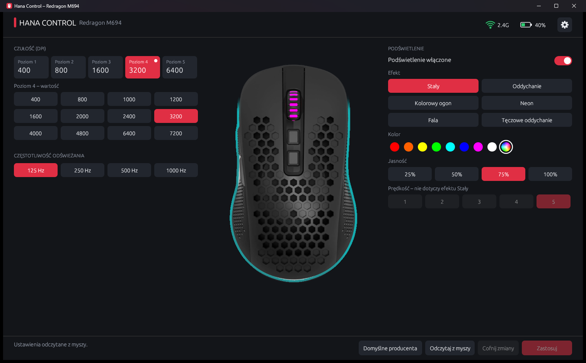

<div align="center">

# Hana Control

**Nieoficjalny panel ustawień myszy Redragon M694 Hana (M694-RGB) dla Windows**

DPI · częstotliwość odświeżania · podświetlenie RGB · bateria — bez oprogramowania producenta

[](https://github.com/MR2042/Red-Dragon-Hana-M694-aplikacja-desktopowa-/releases/latest)


[**⬇ Pobierz instalator**](https://github.com/MR2042/Red-Dragon-Hana-M694-aplikacja-desktopowa-/releases/latest)



</div>

> [!NOTE]
> Projekt nie jest powiązany z Redragon. Protokół myszy został ustalony samodzielnie (patrz [Protokół](#protokół)).
> Aplikacja zapisuje tylko standardowy blok ustawień myszy i nie dotyka firmware.

## Spis treści

- [Funkcje](#funkcje)
- [Szybki start](#szybki-start)
- [Obsługiwane urządzenia](#obsługiwane-urządzenia)
- [Rozwiązywanie problemów](#rozwiązywanie-problemów)
- [Budowanie ze źródeł](#budowanie-ze-źródeł)
- [Protokół](#protokół)
- [Historia zmian](#historia-zmian)

## Funkcje

| | |
|---|---|
| **Czułość (DPI)** | 5 poziomów jak w instrukcji producenta, wartości 400–7200 DPI; kliknięcie poziomu ustawia go jako aktywny |
| **Częstotliwość** | 125 / 250 / 500 / 1000 Hz |
| **Podświetlenie** | Stały, Oddychanie, Kolorowy ogon, Neon, Fala, Tęczowe oddychanie; 8 presetów kolorów + koło barw; 4 poziomy jasności, 5 prędkości; wyłączanie jednym przełącznikiem |
| **Podgląd na żywo** | animowany podgląd podświetlenia na zdjęciu myszy, zanim zapiszesz zmiany |
| **Bezpieczny zapis** | zmiany trafiają do myszy dopiero po *Zastosuj* i są sprawdzane ponownym odczytem; *Cofnij zmiany*, *Domyślne producenta*, kopia oryginalnych ustawień |
| **Kabel i 2.4G** | działa przez odbiornik 2.4 GHz i po kablu USB, sama przełącza się po podłączeniu kabla |
| **Bateria** | poziom i stan ładowania w oknie i w zasobniku; powiadomienie Windows przy 10 % |
| **Praca w tle** | zamknięcie okna chowa aplikację do zasobnika obok zegara; opcjonalny autostart z Windows |

Interfejs po polsku, obsługa wyłącznie przyciskami. Jeden plik `.exe` (~5 MB), bez dodatkowych bibliotek.

## Szybki start

1. Pobierz z [najnowszego wydania](https://github.com/MR2042/Red-Dragon-Hana-M694-aplikacja-desktopowa-/releases/latest):
   - **`HanaControl-Setup-x.y.z.exe`** – instalator (zalecany), albo
   - **`HanaControl.exe`** – wersja przenośna, bez instalacji.
2. Podłącz odbiornik 2.4G lub kabel USB i rusz myszką, żeby ją wybudzić.
3. Uruchom **Hana Control**, zmień ustawienia i kliknij **Zastosuj**.

**Instalator** instaluje tylko dla bieżącego użytkownika (bez uprawnień administratora) do
`%LOCALAPPDATA%\Programs\Hana Control`, tworzy skrót w menu Start (opcjonalnie na pulpicie), może włączyć autostart
i dodaje wpis w *Ustawienia → Aplikacje*, skąd można ją odinstalować. Aktualizacja = uruchomienie nowszego instalatora.

Instalacja cicha (np. do wdrożeń): `HanaControl-Setup-x.y.z.exe --silent`,
odinstalowanie: `"%LOCALAPPDATA%\Programs\Hana Control\uninstall.exe" --uninstall --silent`.

## Obsługiwane urządzenia

| Urządzenie | USB VID:PID | Status |
|---|---|---|
| Redragon M694 Hana – odbiornik 2.4G | `320F:226F` | ✅ przetestowane |
| Redragon M694 Hana – kabel USB | `320F:226E` | ✅ przetestowane |
| Bluetooth | – | ❌ brak kanału konfiguracji |

Inne myszy z układem Telink/Evision (VID `320F`) mogą używać podobnego protokołu, ale nie są obsługiwane.

## Rozwiązywanie problemów

| Problem | Rozwiązanie |
|---|---|
| Windows SmartScreen ostrzega przed programem | Plik nie jest podpisany cyfrowo. Kliknij *Więcej informacji → Uruchom mimo to*. |
| „Nie znaleziono myszy” | Rusz myszką (mysz usypia po 3 min). Sprawdź przełącznik 2.4G/OFF/BT na spodzie – Bluetooth nie jest obsługiwany. Zamknij oficjalne oprogramowanie Redragon, jeśli działa. |
| Nie widać powiadomienia o baterii | Gdy działa gra lub inna aplikacja pełnoekranowa, Windows pokazuje powiadomienia tylko w centrum powiadomień (Win+N). Sprawdź też tryb *Nie przeszkadzać*. |
| Chcę wrócić do ustawień sprzed pierwszego użycia | *Ustawienia aplikacji* (zębatka) → *Przywróć oryginalne ustawienia myszy*. |
| Gdzie są dane aplikacji? | `%APPDATA%\HanaControl` (kopia ustawień myszy, ikona powiadomień). Autostart: `HKCU\Software\Microsoft\Windows\CurrentVersion\Run`. |

## Budowanie ze źródeł

Wymagania: Windows 10/11 x64, [Rust](https://rustup.rs) (stable, `x86_64-pc-windows-msvc`) i Visual Studio Build Tools (C++).

```bash
# aplikacja
cd hana-rs
cargo build --release          # -> hana-rs/target/release/hana_control.exe

# instalator (wbudowuje zbudowaną wcześniej aplikację)
cd ../installer
cargo build --release          # -> installer/target/release/hana_setup.exe
```

Diagnostyka powiadomień: `hana_control.exe --test-notify` (wynik w `%TEMP%\hana_notify.txt`).

### Struktura repozytorium

```
hana-rs/                 aplikacja (Rust, egui/eframe + hidapi)
  src/device.rs          komunikacja USB HID z myszą
  src/config.rs          blok ustawień myszy i wartości producenta
  src/worker.rs          wątek w tle: połączenie, bateria, zapis, powiadomienia
  src/app.rs             interfejs
  src/preview.rs         podgląd podświetlenia
  src/icons.rs           ikony rysowane wektorowo
  src/tray.rs, win.rs    zasobnik systemowy, autostart, powiadomienia Windows
  assets/                ikona aplikacji i grafiki podglądu
installer/               instalator i deinstalator (Rust, egui)
tools/                   skrypty Python (hidapi) użyte do ustalenia protokołu
docs/                    zrzuty ekranu
```

## Protokół

Mysz komunikuje się przez kolekcję HID producenta **Usage Page `0xFF1C`, Usage `0x92`**, raport `0x04`
(63 bajty danych). To wariant protokołu „Evision” opisanego dla myszy AULA
w projekcie [aulaar](https://github.com/shDavlatbek/aulaar). Pola specyficzne dla M694 zostały potwierdzone testami na myszy.

**Pakiet:** `04 | 00 00 CMD LEN OFF_LO OFF_HI 00 | dane…` – odpowiedź ma ten sam nagłówek, dane od bajtu 7.
Porcja danych: `0x18` przez odbiornik, `0x38` po kablu. Brak sumy kontrolnej.

| Komenda | Znaczenie |
|---|---|
| `0x01` / `0x02` | początek / koniec transakcji |
| `0x05` | odczyt 128-bajtowego bloku ustawień |
| `0x06` | zapis bloku ustawień |
| `0x1A` | bateria: `data[7]` = %, `data[8]` = 0 nie ładuje / 1 ładuje / 2 naładowana |
| `0xAA` | czy mysz jest połączona (`data[6]` po kablu, `data[7]` przez odbiornik) |

<details>
<summary><b>Blok ustawień (128 bajtów)</b></summary>

| Bajt | Pole |
|---|---|
| `1` | efekt: 0 stały, 1 oddychanie, 2 kolorowy ogon, 3 neon, 4 fala, 5 tęczowe oddychanie, 6 wyłączone |
| `2` | jasność 1–4 |
| `3` | prędkość efektu (mniejsza wartość = szybciej) |
| `6–8` | kolor RGB podświetlenia |
| `10` / `11` | częstotliwość 2.4G / kabel: 0=125, 1=250, 2=500, 3=1000 Hz |
| `12` | aktywny poziom DPI (0–4) |
| `14 + 9·i` | poziom *i*: `+0` włączony, `+2..3` kod czujnika (u16 LE), `+4..5` wartość DPI (opis), `+6..8` kolor wskaźnika |

Czułość ustawia **kod czujnika**, a nie zapisana obok wartość DPI. Fabryczne pary to
400→7, 800→17, 1600→28, 3200→60, 6400→97. Wartości pośrednie aplikacja przelicza interpolacją,
więc są przybliżone.

</details>

### Ograniczenia

- Tylko Windows.
- DPI spoza fabrycznych punktów jest przybliżone (brak oficjalnej tabeli kodów czujnika).
- Animacje w podglądzie są symulacją – rzeczywiste tempo i kolory zależą od firmware myszy.

## Historia zmian

### v0.2.0
- Pierwsze publiczne wydanie: DPI, częstotliwość, podświetlenie z podglądem, bateria, zasobnik, autostart, powiadomienia.
- Instalator z deinstalatorem i trybem cichym.

## Podziękowania

- [shDavlatbek/aulaar](https://github.com/shDavlatbek/aulaar) – opis protokołu Evision dla myszy AULA.
- [HeyOkay/HaloBattery](https://github.com/HeyOkay/HaloBattery) – odczyt baterii na tym samym kanale HID.

## Licencja

*Do uzupełnienia przez autora (np. MIT).*
